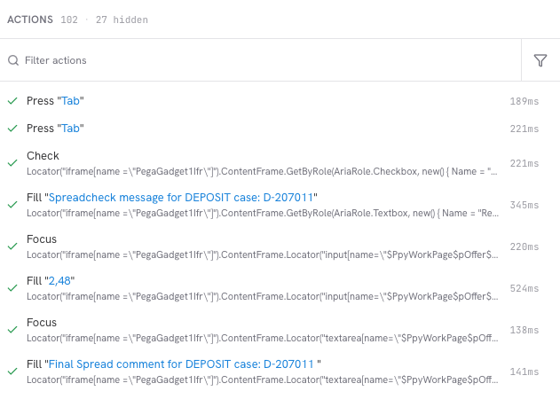
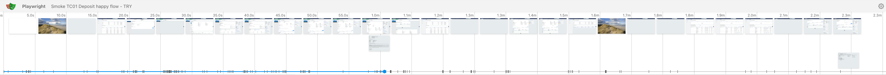
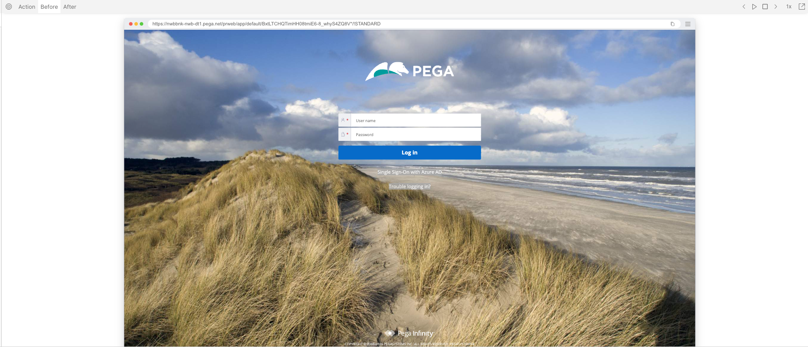
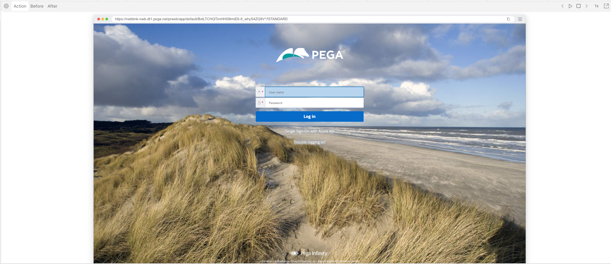

# NwbPlaywright testing for NWB

This is the Test Automation project for de Nederlandse Waterschapbank. The tests are using Playwright, Reqnroll, dotnet.


## Features

This TA project covers features like:

- Client Lifecycle Management
- Deposit
- Loan Update
- Short Loans
- Long Loans
- Pricing Grid
- Swaps

## Installation

Clone the project to your hard disk. Navigate in a console to the location of this project. Execute the following commands:

```console
# Build the project
dotnet build
# Install required browsers - replace netX with actual output folder name, e.g. net10.0
pwsh bin/Debug/netX/playwright.ps1 install

# If the pwsh command does not work (throws TypeNotFound), make sure to use an up-to-date version of Powershell.
dotnet tool update --global Powershell
```

## Usage

To run these Playwright tests, you need to start by building the C# project. After every code change, you need to run the build command again, otherwise the old code build will be used.

### Running the tests on your machine
Locally, I have created aliasses for running specific groups of tests. These command look like this:
```console
dotnet build && dotnet test --filter "TestCategory=Smoke&TestCategory!=BekijkenVoorVerwijdering" --setting .runsettings
```
So it starts with building the project and then it starts to run the tests. I have set the number of workers to 6. Meaning that 6 browsers will start up which each will run a test case. Some tests are marked as NonParallelizable. These tests will run 1 by 1 at the end of the test run. This is why the end feels very slow. The result (of the building and of the running of the tests) is placed in the ./bin/Debug/net10.0/ folder inside the project folder. This is also the location where the executable for Playwright is placed.

In the logging in the command line, you can see the progress. I've created a Hook (./Hooks/TestProgress.cs) that shows the progress during the run. After each test is done, a line is printed that shows the number of run tests and the total number of tests AND it shows how many tests have passed, how many failed AND it show the result and name of the last completed test. `$"{Cyan}Progress: {_passed + _failed}/{Total} tests run{Reset} | {Green}Passed: {_passed}{Reset} | $"{failedColor}Failed: {_failed}{Reset} | {result}: {scenarioContext.ScenarioInfo.Title}");`. Keep in mind that this is not a good indicator of how long the rest of the test run is going to take.

When the test run is done, there should be a short overview of the number of tests (passed, failed, run). Next to this, for every failed test there will be an traceviewer-file (placed in ./bin/Debug/net10.0/playwright-traces). This traceviewer-file can show ALL the information of every step inside test test case. You can use the Traceviewer locally (it is part of the Playwright installation), but maybe this online version is more convenient: https://kinora.dev/trace/. You can drag the .zip-file from inside the playwright-traces folder to the website.

### How to use the Trace Viewer
When you open a file in the Trace Viewer, you see a couple of panes. In the *left* pane, you can see every action (Fill/Focus/Click/Wait for selector/etc..) that was performed in the test case. You can see which data was used in that action AND how long the action took. When the action failed, there will be a red cross next to it.

In the *right top* pane, you see the timeline. In the timeline, you see screenshots, the green bars show the passed steps and the red bar shows the failing step. This failing step will always take 30 seconds.

In the *right center* pane, you see the current status of the screen inside the test. In the top-left part of this pane, you see three tabs ('Before', 'Action' and 'After'). 'Before'-button shows what the screen looked like before the action, 'Action'  shows with a big red dot what action is performed and 'After' shows how the screen reacted to the action. During each of these steps, you can use the right bottom pane, which shows all the browser information (like you would in the actual browser's Developer tools), the REST calls that were performed (inside the 'Network'-tab), the Errors show the browser errors and 'Source'-tab shows the Playwright code that was performed in that step.





A test fails when the action is not able to be finished within 30 seconds. There can be a number of reasons for this:
- The element on which the action should take place is not showing/actionable
-


#### Combinations of Products/Counterparties

The following combinations of department, counterparty, test user and loan type are exercised by the feature files in `Features/`:

| Department | Counterparty | TestUser | LoanType |
| --- | --- | --- | --- |
| PF | Bouwbedrijf Verkerk B.V. | AccountDesk1 | Fixed, Variable, Short |
| PF | Trx Dunder Mifflin Paper Company | AccountDesk1 | Fixed, Variable, Short, Base Rate, Deposit |
| PF | Trx Gemeente Meerdijk | AccountDesk1 | Fixed, Variable, Short, Base Rate, Deposit |
| PF | Trx HVC N.V. | AccountDesk1 | Fixed, Variable, Short |
| PF | Trx Samenwerkingsverband Nul | AccountDesk1 | Short |
| PF | Trx Samenwerkingsverband Twintig | AccountDesk1 | Short |
| PF | Trx Stichting Greendale Wonen | AccountDesk1 | Fixed, Variable, Base Rate, Deposit |
| PF | Trx Stichting Groenfonds | AccountDesk1 | Fixed, Variable, Short |
| PF | Trx Stichting Zorggroep Heilig Hart | AccountDesk1 | Fixed, Variable, Short, Base Rate, Deposit |
| PF | Trx Stichting nationaal restauratiefonds | AccountDesk1 | Fixed, Variable, Short, Deposit |
| PF | Trx Waterschap Groot Waterland | AccountDesk1 | Fixed, Variable, Short, Base Rate |
| TRY | Trx Dunder Mifflin Paper Company | SpecializedFinanceTRX1 | Deposit |
| TRY | Trx Dunder Mifflin Paper Company | Treasury1 | Fixed, Variable |
| TRY | Trx Stichting Zorggroep Heilig Hart | Treasury1 | Fixed, Variable, Short, Deposit |
| TRY | Trx Waterschap Groot Waterland | Treasury1 | Fixed, Variable, Short, Base Rate |
| TRY | Trx Dunder Mifflin Paper Company | TreasuryManager1 | Short, Deposit |
| TRY | Trx Gemeente Meerdijk | TreasuryManager1 | Deposit |
| TRY | Trx Stichting Zorggroep Heilig Hart | TreasuryManager1 | Variable, Deposit |


## Contributing

Things I want to do:
- [X] Know how run grouped tests (tagging/grouping)
- [X] Test reports after each run
- [ ] Running tests in pipeline (Azure Pipeline, since we are using Azure DevOps?)
- [ ] Sonarqube or alternative for code quality
- [ ] Linting
- [ ]